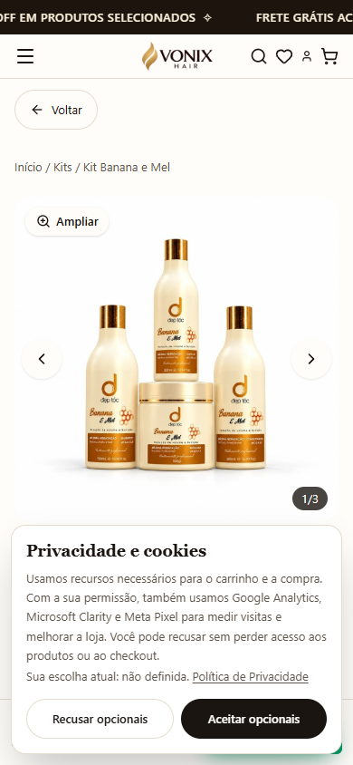
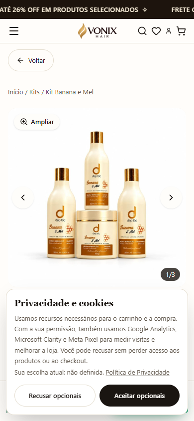
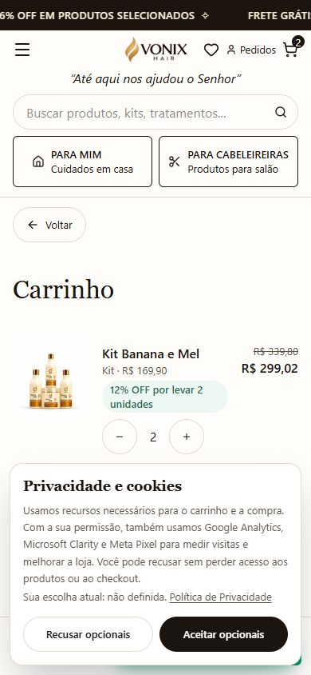

# Vonix Hair — mapa claro de alterações no e-commerce (C22)

**Projeto exclusivo:** e-commerce `vonix-hair-care`, branch de auditoria `fix/vonix-ecommerce-auditoria-2026-11-09`, PR #26. **Não é um redesign final e ainda não foi publicado em produção.**

## O que eu realmente mexi e onde aparece

| Tela | Problema para o cliente | Correção feita no código | Como conferir |
|---|---|---|---|
| **Produto** `/produto/kit-cachos` → `/produto/kit-banana-e-mel` | Ao selecionar 3 unidades do primeiro kit e navegar para o segundo, **a quantidade errada (3) ficava ativa** | Cada troca de produto cria seu próprio estado de compra: começa com **1 unidade**, primeira variante e gaveta fechada. Não exclui itens que já estavam no carrinho. | Abrir o primeiro produto, selecionar 3 unidades, clicar num kit recomendado. No segundo, o seletor deve mostrar 1. |
| **Produto — botões +/−** | Área de toque estreita e rótulos genéricos | Áreas mínimas de **44×44 px**, botão de diminuir desativado em 1 e de aumentar desativado em 99; nome do produto anunciado para leitores de tela. | Inspecionar no mobile e pressionar +/-; testar limites. |
| **Produto — coração** | O botão dizia apenas “Favoritar”, mesmo quando já estava marcado | Estado acessível `aria-pressed`, com texto **Adicionar/Remover [produto] aos/dos favoritos**. | Marcar/desmarcar, inclusive com leitor de tela. |
| **Carrinho mobile** `/carrinho` | O botão fixo “Finalizar minha compra” escondia o subtotal, exigindo rolar a tela | Agora exibe **“Produtos, sem frete” + valor atualizado da sacola**, ao lado do CTA. Não promete total final nem frete gratuito. | Abrir no celular e aumentar a quantidade para ver o valor mudar. |

### Imagens reais do navegador local (Chrome)

**Antes: 3 unidades herdadas do outro produto.**

**Depois: novo produto inicia com 1 unidade.**

**Carrinho no celular: subtotal de produtos sem frete.**

As capturas adicionais das larguras 320, 390 e 1366 px estão nas pastas `qa-artifacts/vonix-c22/dev` (teste de falha reproduzida) e `qa-artifacts/vonix-c22/green-verified` (versão corrigida).

## Correções anteriores C17–C21, para não confundir com as novas

- **Checkout:** botão Enter do código de cupom aplica o cupom sem submeter o pagamento; CPF destaca erro; recuperação de pagamento incerto evita tentar cobrar duas vezes; confirmação server-side de cupons e do valor cotado antes de cobrar.
- **Sacola:** descontos por quantidade, controles acessíveis, ofertas não cumulativas, validação de itens antigos, atualização entre abas.
- **Loja:** pesquisa por botão e sem acentos, filtros legados “Combos” convertidos em “Kits” sem quebrar links.
- **Favoritos e avaliações:** recuperação de dados corrompidos, deduplicação de avaliações, estado de avaliação separado por produto, não indexação de páginas locais.
- **Frete:** sem prometer transportadora ou gratuidade antes da cotação por CEP; 42 produtos ativos verificados por SSR.

**Ponto importante:** correções de checkout, integridade e acessibilidade frequentemente não mudam a aparência geral da home. São melhorias reais, mas não equivalem a redesenhar a loja.

## O que ainda NÃO está concluído

- **Visual premium do e-commerce inteiro:** identidade visual consistente, refinamento de home/banners/categorias, acabamento do produto, performance e imagens, fluxo de checkout no navegador real de staging. Os ciclos de auditoria anteriores não concluíram um redesign global.
- **Venda operacional:** homologação Appmax sandbox (Pix/cartão, antifraude, duplicidade, `paid_at`), Supabase isolado (RLS, backups/restore), estoque e dimensões Bling, cotação de frete real e Cloudflare Worker staging.
- **Privacidade e mensuração:** revogação de consentimento após pedido, rate limit/WAF e GA4/Meta apenas para pedidos realmente pagos.
- **Dívida técnica:** lint global estrito acusa problemas históricos de formatação/CRLF; o ESLint de regras funcionais e o Prettier dos arquivos editados são gates separados.

**Conclusão:** versão C22 é um incremento auditado em branch, não aprovação para vender ou deploy. Prioridade futura recomendada: trabalho visual sistêmico rastreável e homologação de integrações em staging, em vez de declarar a loja pronta a cada correção isolada.
